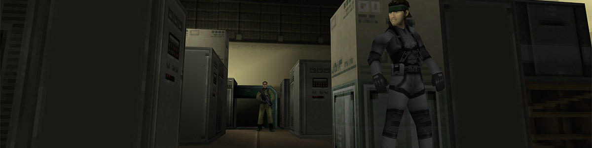

# Metal Gear Solid Mobile — Native Port

A native port of *Metal Gear Solid Mobile* (Ideaworks3D / Kojima Productions, 2008), originally released for the Nokia N-Gage 2.0. No Symbian emulator is involved: the game's own ARM code runs in a CPU emulator (Unicorn) on Windows, Linux and Android, and directly on the CPU on the New 3DS and PS Vita; the engine calls it makes for graphics, sound, input and files are answered by native code.

This project is neither a decompilation nor a static recompilation, and no part of this project is human written. No one deserves credit for this release except for the hard working individuals who created the game in 2008. LLM driven projects like this should focus entirely on preserving, presenting, and making available the incredible works made by real human beings.

This repository contains **no game data**. You need your own copy of the game (`Metal.Gear.Solid.n-gage`, 2,542,447 bytes, SHA-256 `575afba9a431775edd30e20a54e23380d182560d7d51db90ae5edd5b810b2d81`); the first run extracts the files and installs it.

## Enhancements

- **Runs on** Windows, Linux, Android, the New 3DS (homebrew, with stereoscopic 3D) and the PS Vita (homebrew)
- **Widescreen / Arbitrary Resolution Support**: the 3D view fills any window shape, with an adjustable field of view; the original 320x240 mode is still there
- **An untouched original presentation** of the game's menus
- **Sharper rendering**: native resolution, supersampling and MSAA (desktop), or the game's own software renderer
- **60 fps**
- **Controllers**: gamepad support and rebindable keys; on-screen touch controls on Android
- **Better movement** (optional, off by default): diagonal movement and analog steering with the stick
- **Settings overlay** (F1, or Back / R3 on a pad; Select on the Vita) that pauses the game; settings are saved to `mgs_mobile.ini`
- **Custom textures**: every texture is extracted to `textures\` as PNG; edited or new PNGs of any size replace them in game
- **Screenshots** (F12) and a **photo mode** (F5) with camera and frame stepping
- **Debug mode**: level select, inventory editor, cheats, and texture and model viewers

## Getting started

| Platform | Build |
|---|---|
| Windows | `mgs_native\build.bat` (Visual Studio 2022, CMake, Ninja, Python with `pip install unicorn==2.1.4`) |
| Linux | `bash mgs_native/build.sh` (C++17 compiler, CMake, Ninja, SDL 3, Unicorn 2.1.4) |
| Android | `python android/build.py` (Android SDK + NDK 24, JDK 17) |
| New 3DS | `mgs_native\3ds\build.bat` (devkitPro with `3ds-dev`). Copy your `.n-gage` to `sdmc:/3ds/mgs_mobile/`; the first start installs it |
| PS Vita | `mgs_native/vita/build.sh` (VitaSDK; run `mgs_native/vita/build_vitagl.sh` once first). Needs kubridge (HENkaku / Ensō). Install the VPK and copy your `.n-gage` to `ux0:data/mgs_mobile/`; the first start installs it |

Run `mgs_mobile` and point the setup window at your `Metal.Gear.Solid.n-gage` (or use `--install <file>`).

**Keyboard**: arrows move, Z = action, C = first person, Enter = OK, A = pause menu, X = equipment, F1 = settings.

## License

The port's own code is licensed under the GNU General Public License, version 2 or (at your option) any later version (`LICENSE`), as required by Unicorn. Bundled third-party code keeps its own licence (`licenses/THIRD_PARTY.txt`).

*Metal Gear Solid Mobile* is © Konami Digital Entertainment. This is an unofficial project, not affiliated with or endorsed by Konami.
